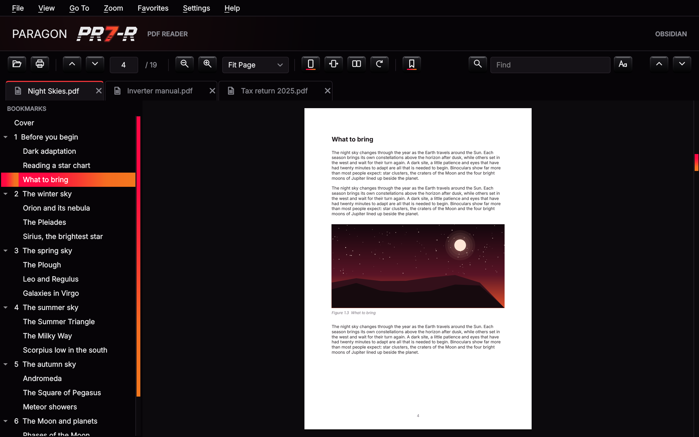

# Paragon PR7-R

A PDF reader for Windows 10/11 that works the way **SumatraPDF** works, in the Paragon family look (PR7-Z, PR7-W,
PR7-L, PR7-F, PR7-E). Python, PySide6 and Qt's own PDF engine (QtPdf, which is Google's PDFium).



## What it does

- **Tabs**: every document in a tab; opening more PDFs from Explorer adds tabs to the open window.
- **Start page**: Frequently read, as thumbnails; documents reopen at the page, zoom and layout they were left at.
- **Views**: single page, facing, book view (the cover alone on the right); continuous or a spread at a time;
  rotate left / right; presentation (F5) and fullscreen (F11).
- **Zoom**: fit page, fit width, actual size, Sumatra's steps (8.33% - 6400%), custom; Ctrl+wheel zooms at the mouse.
- **Bookmarks** panel (the PDF's outline), following the page being read.
- **Find** (Ctrl+F, F3, Shift+F3, Match case): matches marked on the pages, "4 of 14".
- **Links**: click to follow, Back / Forward (Alt+Left / Alt+Right) through the places jumped from.
- **Text**: drag over text to select it, Ctrl+C to copy, Ctrl+A for all of it.
- **Favorites**, recent files, Go to page (Ctrl+G), Print (Ctrl+P), Properties (Ctrl+D), Save As, Rename (F2),
  Show in folder (in PR7-E when it's the folder app).
- **Passwords**: protected PDFs ask for theirs.
- The file changed on disk (re-exported by another program): reloaded at the same page.
- Check for updates, the OBSIDIAN and AURORA finishes.

PR7-R reads PDF files. (SumatraPDF also reads EPUB, XPS, CBZ and DjVu; Qt's PDF engine doesn't.)

## Install

Download `PR7-R-Setup-x.y.z.exe` from Releases. It installs for you only (no admin rights) and registers PR7-R as a
PDF reader. To make it the default: Settings > Options > "Make PR7-R the default PDF reader", which opens Windows'
Default apps at PR7-R (Windows only lets you make that choice).

## Develop

```
pip install -r requirements.txt -r requirements-dev.txt
python -m pr7r some.pdf
python -m pytest
QT_SCALE_FACTOR=2 python tools/screenshots.py OUT
```
